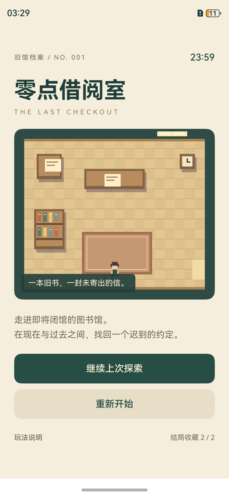
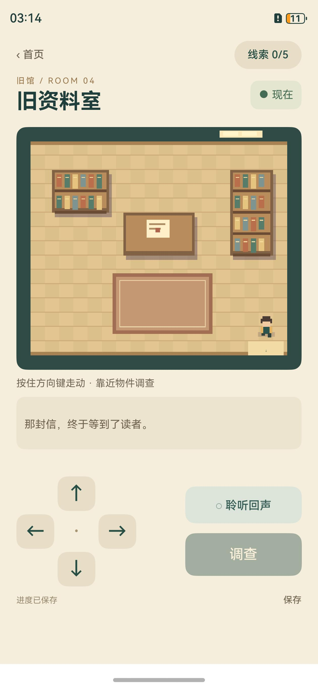
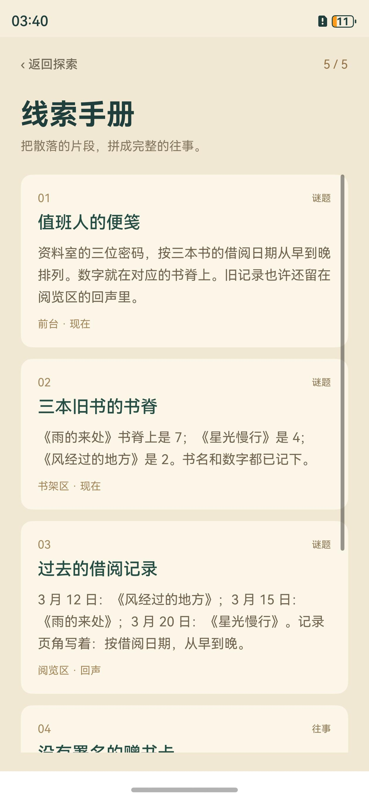

# 零点借阅室 · ZeroHourLibrary

一款使用 **ArkTS + ArkUI** 开发的 HarmonyOS 二维俯视角探索游戏。控制角色走进即将改造的旧图书馆，在现在与过去的「回声」中寻找一封未寄出的信。

- GitHub 账号：[wxrsunny](https://github.com/wxrsunny)
- 公开仓库：[wxrsunny/ZeroHourLibrary](https://github.com/wxrsunny/ZeroHourLibrary)
- 单人课程项目，使用 Codex 辅助实现与验证。
- 当前状态：功能完成；实际构建、安装、23 项模块测试和 13 项鸿蒙模拟器验收通过。正式个人 Word 报告待补充姓名、学号后在本地制作。

## 玩法

按住屏幕方向键自由走动，靠近物件后调查。四个房间之间通过门口相连，墙壁、桌面和书架会阻挡角色。切换「现在 / 回声」寻找不同信息，在手册中整理五条线索，推导一个三位密码，并作出影响两个结局的最终选择。

进度自动保存；重启应用后可以继续。重新开始需确认，并保留已收藏的结局。不依赖服务器或联网运行。地图、人物及装饰使用 Canvas 绘制，采用温暖的纸张、木色和墨绿配色。

## 实际运行展示

以下均为 HarmonyOS 模拟器真实运行画面。

| 主菜单 | 场景探索 | 线索手册 |
| --- | --- | --- |
|  |  |  |

[查看实际操作录屏（MP4，约 4 分钟 / 1.4 MB）](docs/demo/zero-hour-library.mp4) · [全部 16 张截图](docs/screenshots)

录屏由模拟器实际连续截图按真实时间重采样为 5 fps，无音频；包含谜题、选择与后续验收操作。若 GitHub 不直接播放，点击文件页的 **View raw / Download raw file** 后本地播放。

## 开发环境与运行

已验证：DevEco Studio **5.0.13.240**、HarmonyOS **5.0.5 / API 17**、Huawei_Phone x86_64 模拟器、Stage 模型、手机竖屏。构建与测试使用 DevEco 自带 Node.js 18.20.1、Java 17 和 OHPM 5.0.19。

1. 克隆仓库，或下载 ZIP 后解压。
2. 在 DevEco Studio 选择 Open，打开包含 `build-profile.json5` 的工程根目录；等待工程同步完成。
3. 确保安装 API 17 SDK，启动 Huawei_Phone 模拟器，选择 `entry` 和目标设备后点击运行。
4. 点击「开始探索」，按住方向键移动，靠近值班台调查。

Windows PowerShell 也可执行（将路径改为自己的 DevEco 安装位置）：

```powershell
.\scripts\build.ps1 -DevEcoHome 'D:\Harmony\DevEco Studio'
.\scripts\test.ps1 -DevEcoHome 'D:\Harmony\DevEco Studio'
```

构建输出：`entry/build/default/outputs/default/entry-default-unsigned.hap`。已通过 HDC 在上述本地模拟器安装运行；工程未配置个人签名，真机安装或发布需在 DevEco 配置签名。本仓库不包含签名证书或机器专属配置。

## 测试与代码结构

- **23 / 23 模块测试通过**：正常 8、边界 8、异常 7。直接加载项目平台无关业务模块，使用存储 Mock 验证读写失败和顺序保存；不以此代替平台实测。
- **13 / 13 模拟器检查通过**：实际方向键输入、碰撞、调查、回声、跨房间、密码、两个结局、后台恢复、强制停止后恢复、门口边界回归等。
- [测试与验收结果](docs/测试与验收结果.md) · [模块结果 JSON](tests/results/module-tests.json) · [模拟器结果 JSON](tests/results/emulator-tests.json)

```text
entry/src/main/ets/
  model/         显式数据类型与进度创建
  data/          四房间地图、线索和剧情定义
  logic/         移动、碰撞、调查、谜题、结局
  storage/       存档编解码、Mock 接口、Preferences、会话
  components/    Canvas 地图与方向键
  pages/         首页、探索、手册、结局
  entryability/  UIAbility 入口和生命周期
tests/           业务模块测试及实际结果
scripts/         Windows 构建与测试入口
docs/            需求、架构、验收、开发记录及真实媒体
```

## 设计与交付资料

- [软件需求说明书](docs/软件需求说明书.md)（需求初版先于代码提交）
- [系统架构与实际接口](docs/系统架构.md)
- [评分要求与验收计划](docs/评分要求与验收计划.md)（开发前计划）
- [运行与演示说明](docs/运行与演示说明.md)（含可折叠谜题答案）
- [开发记录与真实 Commit](docs/开发记录.md)

学习通最终答案需同时填写仓库链接 `https://github.com/wxrsunny/ZeroHourLibrary` 与账号 `wxrsunny`。个人姓名、学号和正式个人报告不放入公开仓库。
