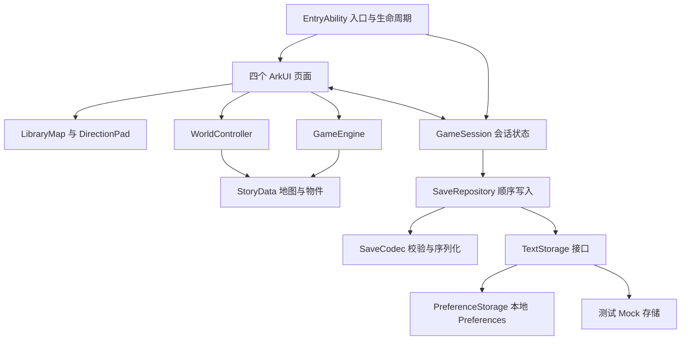

# 系统架构与实际接口

本项目是单人课程项目，全部模块均属于个人负责范围，使用 Codex 辅助实现与验证。以下与最终源代码对应。

## 页面与状态流

`Index` 初始化会话并提供新游戏、继续和说明；`Explore` 渲染地图、调查对话、密码输入与回声状态；`Notebook` 显示已发现的线索；`Ending` 展示结局和收藏。

方向键定时输入调用 `movePlayer`，其返回新的进度快照。`Explore` 更新 `gameSession.progress`，使用本地响应式状态触发重绘；调查和谜题函数按约定修改传入进度。回声由页面切换 `era`，再交给统一的剧情判断。页面间导航使用 ArkUI router。

`EntryAbility.onBackground` 将前台标志置为 false，使探索停止移动，并请求保存；`onForeground` 恢复标志。停止移动、调查、切换时代、换房等操作节点保存，避免逐帧写盘。所有页面使用同一会话。

## 模块接口

路径均以 `entry/src/main/ets/` 为起点。

| 模块 | 主要实际接口 | 约定 |
| --- | --- | --- |
| model/GameTypes | `createProgress(endings: EndingId[] = []): GameProgress`；`cloneProgress(p): GameProgress` | 新进度复制结局集合，避免共享可变数组 |
| data/StoryData | `getScene(id: RoomId): SceneDefinition`；`getClue(id: string): ClueDefinition \| undefined` | 320×272 逻辑地图，人物半径 6，调查距离 30 |
| logic/WorldController | `canStand(scene, point): boolean`；`nearbyObject(progress): MapObject \| undefined`；`movePlayer(progress, direction, step = 4): MoveResult` | 不修改原进度；拒绝非法步长；障碍、边界、方向与锁定共同决定通行 |
| logic/GameEngine | `investigate(progress, objectId): InteractionResult`；`submitPuzzle(progress, input): string`；`chooseEnding(progress, ending): string` | 在合法距离和条件内修改进度；错误返回提示，不非法推进 |
| storage/SaveCodec | `encodeSave(progress): string`；`decodeSave(raw): LoadResult` | 版本、字段、场景、线索与坐标校验；非法坐标回退安全点 |
| storage/SaveRepository | `load(): Promise<LoadResult>`；`save(progress): Promise<SaveResult>` | 注入 TextStorage；保存前取快照，按调用顺序串行写入；失败返回明确结果 |
| storage/PreferenceStorage | `read(): Promise<string>`；`write(value): Promise<void>` | 实现 TextStorage；Preferences 名 zero_hour_library，键 game_save_v1；put 后 flush |
| storage/GameSession | `initialize(context): Promise<void>`；`save(): Promise<SaveResult>` | 管理 progress、hasSave 和 warning，供页面和生命周期复用 |
| components/LibraryMap | 进度输入 → Canvas 场景 | 按逻辑坐标缩放绘制，时代改变视觉 |
| components/DirectionPad | 方向按下和释放 → 页面回调 | 按住持续移动，释放、取消或页面离开停止 |

## 数据与存储

`GameProgress`：room、position、facing、era、clues、visitedRooms、archiveUnlocked、letterFound、ending、unlockedEndings、steps。房间、时代、方向和结局使用联合类型。物件包含矩形范围、是否实体、两时代文案、线索标识及所属时代。

`SaveEnvelope` 包含 version、savedAt 和 progress。`LoadResult` 包含可空进度与 warning；`SaveResult` 包含 success 和 message。首次启动没有存档是正常情况；损坏存档不伪造成功；坐标异常恢复到安全点并提示；存储异常由仓库捕获并反馈。新游戏通过 `createProgress(old.unlockedEndings)` 清空本轮并保留收藏。

## 可验证性

WorldController、GameEngine、SaveCodec 和 SaveRepository 不依赖平台 Kit。Node 宿主测试转译并执行同一份模块；读取/写入异常通过 TextStorage 替身注入。Preferences、UI、生命周期另由实际鸿蒙模拟器检查验证，结果分别保存。
