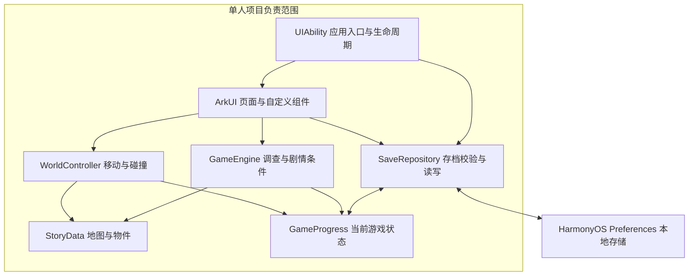

# 系统架构

本项目由一名学生负责全部模块，使用 Codex 辅助实现与验证。下图标示单人项目的职责范围，最终报告应以已完成的代码与实际操作证据说明各部分。

## 数据流

方向键输入交给 WorldController，按地图边界与障碍判断移动是否合法，产生新的角色位置。角色靠近物件时，界面根据距离显示调查入口。GameEngine 接收物件标识和当前进度，判断当前时代与剧情条件，返回可展示的信息并更新线索、门锁或结局状态。

界面展示同一份显式类型的 GameProgress。保存发生在移动结束、调查、房间切换等操作节点，进入后台时也尝试保存。SaveRepository 负责校验与序列化，避免界面直接操作存储细节。

## 模块约定

| 模块 | 输入 | 输出或职责 |
| --- | --- | --- |
| StoryData | 场景、线索或物件标识 | 确定的地图和剧情定义 |
| WorldController | 角色坐标、方向、地图 | 合法新坐标、附近物件、门口触发 |
| GameEngine | 进度、调查或剧情操作 | 新的业务状态与操作反馈 |
| SaveRepository | 进度或本地存档字符串 | 保存结果或校验后的恢复状态 |
| 页面与组件 | 状态及用户操作 | 地图、按钮、线索、对话与结局展示 |

具体导出类型与函数签名将在模块实现后同步到文档；正常、边界与异常测试直接覆盖业务判断与存档接口。
